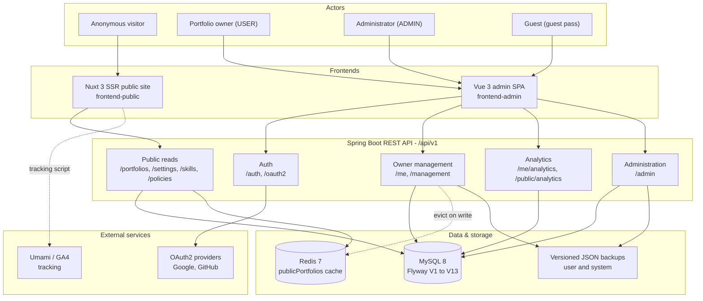
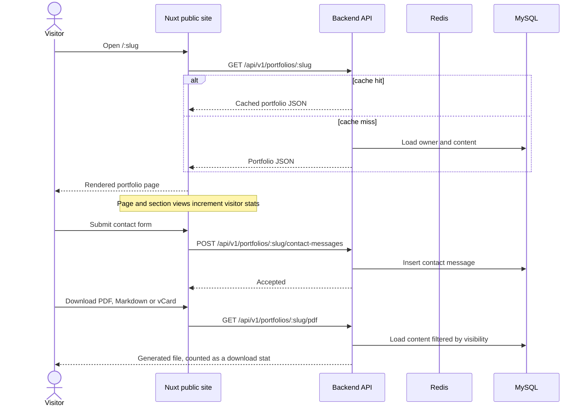
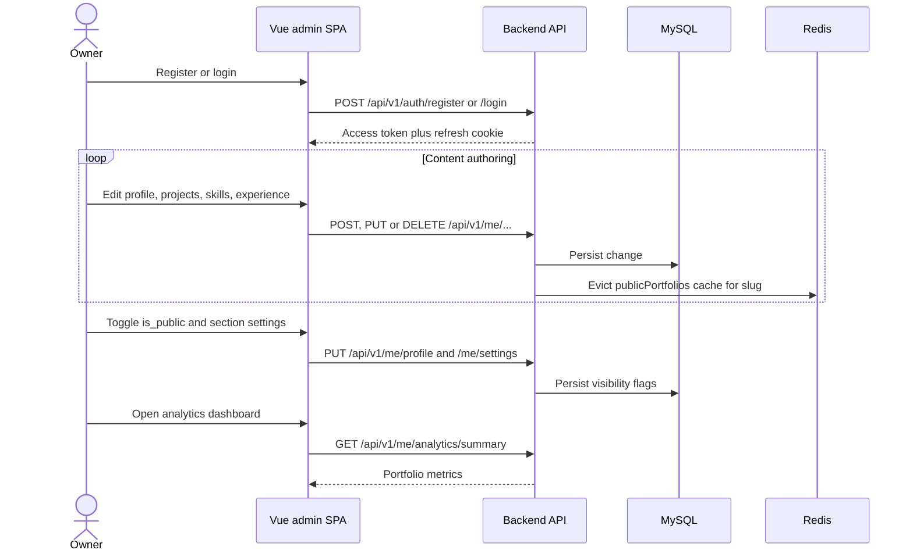
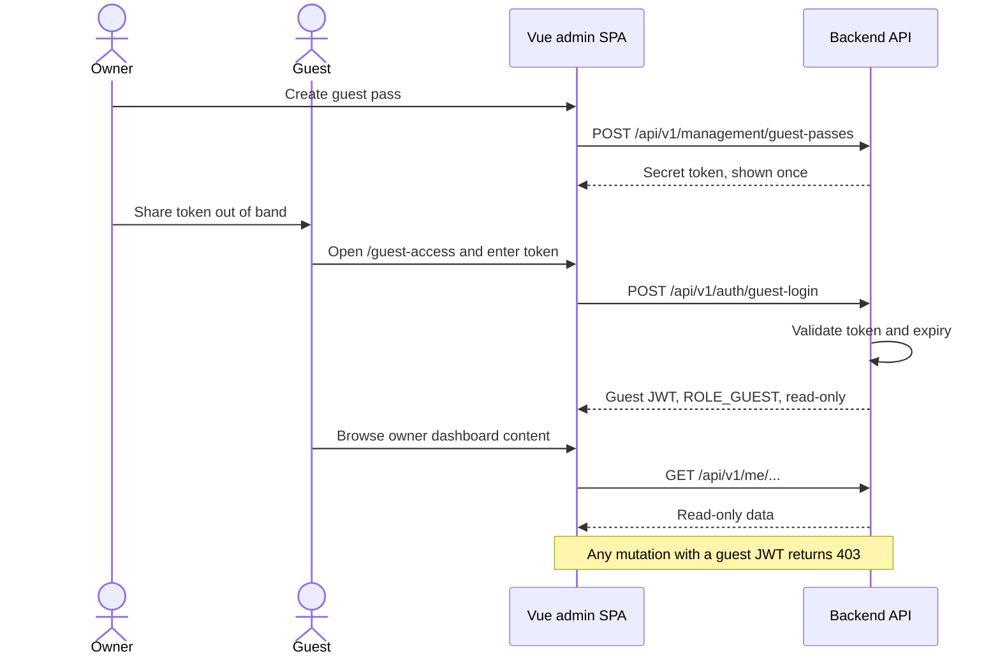
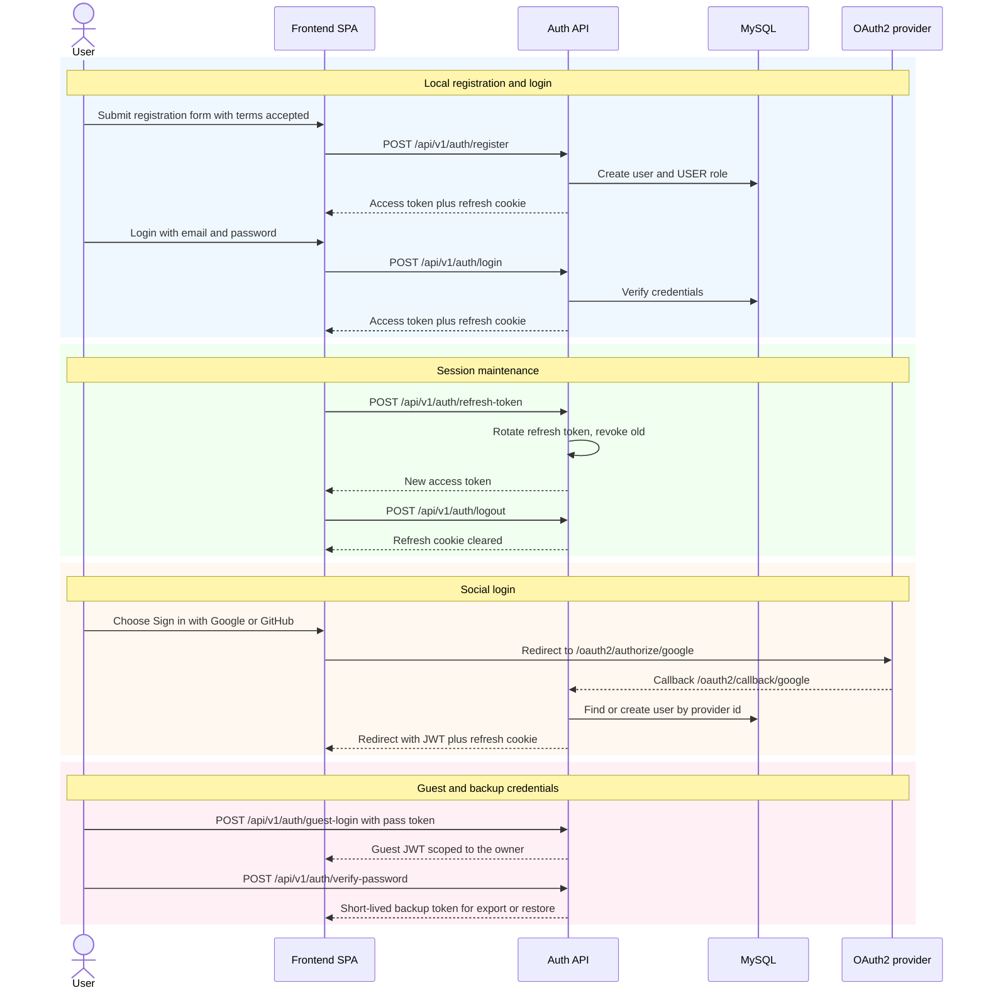
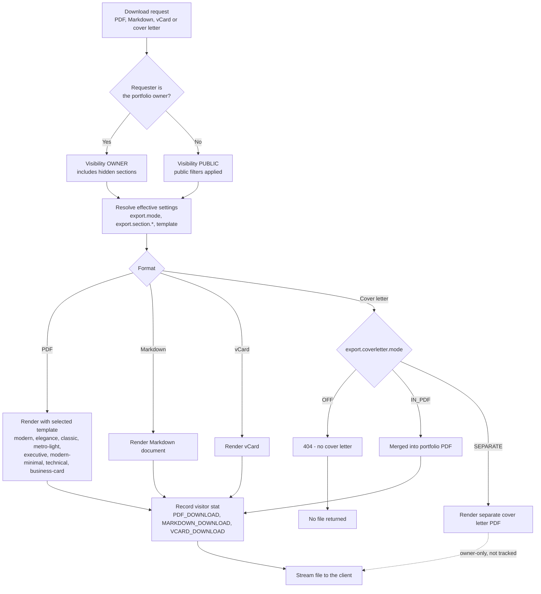

# ForkMyFolio — System Diagrams

**Task:** D2 — Mermaid diagrams for the whole system: end-to-end feature map,
key user flows, auth flow, export flow and the entity-relationship diagram.

Companion to [`FEATURES.md`](FEATURES.md). Sources of truth: the JPA entities
in `backend/src/main/java/com/forkmyfolio/model/` and the Flyway migrations
`V1`–`V13` in `backend/src/main/resources/db/migration/`.

---

## 1. End-to-end feature map

---

## 2. Key user flows

### 2.1 Visitor browses and contacts an owner

### 2.2 Owner builds and publishes a portfolio

### 2.3 Guest pass access (read-only)

---

## 3. Authentication flow

---

## 4. Export and download flow

---

## 5. Entity-relationship diagram

All 24 tables. Internal `BIGINT` primary keys are paired with external
`UUID` identifiers on user-facing entities (the "internal Long ID / external
UUID ID" standard). Join tables are shown as entities.

```mermaid
erDiagram
    USERS ||--o{ USER_ROLES : has
    USERS ||--o| PORTFOLIO_PROFILES : owns
    USERS ||--o{ REFRESH_TOKENS : has
    USERS ||--o{ PROJECTS : owns
    USERS ||--o{ EXPERIENCES : owns
    USERS ||--o{ QUALIFICATIONS : earns
    USERS ||--o{ TESTIMONIALS : receives
    USERS ||--o{ USER_SKILLS : picks
    USERS ||--o{ USER_SETTINGS : configures
    USERS ||--o{ CONTACT_MESSAGES : receives
    USERS ||--o{ GUEST_PASSES : issues
    USERS ||--o{ JOB_APPLICATIONS : tracks
    USERS ||--o{ ANNOUNCEMENTS : sends
    USERS ||--o{ ANNOUNCEMENT_READS : marks
    USERS ||--o{ USER_ANALYTICS_CONFIG : configures
    PROJECTS ||--o{ KEY_FEATURES : lists
    PROJECTS ||--o{ PROJECT_SKILLS : contains
    SKILLS ||--o{ PROJECT_SKILLS : tags
    EXPERIENCES ||--o{ EXPERIENCE_SKILLS : contains
    SKILLS ||--o{ EXPERIENCE_SKILLS : tags
    USER_SKILLS }o--|| SKILLS : references
    JOB_APPLICATIONS ||--o{ JOB_APPLICATION_NOTES : notes
    ANNOUNCEMENTS ||--o{ ANNOUNCEMENT_READS : read_by

    USERS {
        BIGINT id PK
        BINARY uuid UK
        VARCHAR slug UK
        VARCHAR email UK
        VARCHAR first_name
        VARCHAR last_name
        VARCHAR password
        VARCHAR profile_image_url
        ENUM provider
        VARCHAR provider_id
        BIT active
        BIT email_verified
        DATETIME password_last_changed_at
        DATETIME terms_accepted_at
        VARCHAR terms_version
        DATETIME created_at
        DATETIME updated_at
    }

    USER_ROLES {
        BIGINT user_id PK, FK
        ENUM role PK
    }

    REFRESH_TOKENS {
        BIGINT id PK
        VARCHAR token UK
        DATETIME expiry_date
        BIGINT user_id FK
    }

    PORTFOLIO_PROFILES {
        BIGINT id PK
        BINARY uuid UK
        BIGINT user_id FK, UK
        VARCHAR headline
        TEXT summary
        VARCHAR public_email
        VARCHAR website_url
        VARCHAR linkedin_url
        VARCHAR github_url
        VARCHAR resume_url
        VARCHAR resume_image_url
        VARCHAR location
        TEXT cover_letter_template
        BIT visible
        BIT is_public
        BOOLEAN search_indexable
        DATETIME created_at
        DATETIME updated_at
    }

    PROJECTS {
        BIGINT id PK
        VARCHAR uuid UK
        BIGINT user_id FK
        VARCHAR title
        TEXT description
        INT display_order
        VARCHAR image_url
        VARCHAR media_url
        VARCHAR live_url
        VARCHAR repo_url
        BIT visible
        DATETIME created_at
        DATETIME updated_at
    }

    KEY_FEATURES {
        BIGINT id PK
        VARCHAR uuid UK
        BIGINT project_id FK
        VARCHAR value
        INT display_order
    }

    PROJECT_SKILLS {
        BIGINT project_id PK, FK
        BIGINT skill_id PK, FK
    }

    SKILLS {
        BIGINT id PK
        BINARY uuid UK
        VARCHAR name UK
        ENUM level
        VARCHAR category
        VARCHAR icon
        LONGTEXT description
        BIT visible
        DATETIME created_at
        DATETIME updated_at
    }

    USER_SKILLS {
        BIGINT id PK
        BINARY uuid UK
        BIGINT user_id FK
        BIGINT skill_id FK
        ENUM level
        LONGTEXT description
        BIT visible
        DATETIME created_at
        DATETIME updated_at
    }

    EXPERIENCES {
        BIGINT id PK
        VARCHAR uuid UK
        BIGINT user_id FK
        VARCHAR job_title
        VARCHAR company_name
        VARCHAR company_url
        VARCHAR company_logo_url
        VARCHAR location
        ENUM location_type
        ENUM employment_type
        DATE start_date
        DATE end_date
        TEXT description
        TEXT achievements
        INT display_order
        BIT visible
        DATETIME created_at
        DATETIME updated_at
    }

    EXPERIENCE_SKILLS {
        BIGINT experience_id PK, FK
        BIGINT skill_id PK, FK
    }

    QUALIFICATIONS {
        BIGINT id PK
        VARCHAR uuid UK
        BIGINT user_id FK
        VARCHAR qualification_name
        VARCHAR institution_name
        VARCHAR institution_logo_url
        VARCHAR institution_website
        VARCHAR field_of_study
        ENUM level
        INT start_year
        INT completion_year
        VARCHAR grade
        VARCHAR credential_url
        BIT still_studying
        BIT visible
        DATETIME created_at
        DATETIME updated_at
    }

    TESTIMONIALS {
        BIGINT id PK
        VARCHAR uuid UK
        BIGINT user_id FK
        TEXT quote
        VARCHAR author_name
        VARCHAR author_title
        BIT visible
        DATETIME created_at
        DATETIME updated_at
    }

    CONTACT_MESSAGES {
        BIGINT id PK
        VARCHAR uuid UK
        BIGINT user_id FK
        VARCHAR name
        VARCHAR email
        TEXT message
        ENUM priority
        BIT is_read
        BIT is_replied
        BIT is_archived
        DATETIME created_at
    }

    SETTINGS {
        BIGINT id PK
        VARCHAR uuid UK
        VARCHAR name UK
        VARCHAR value
        VARCHAR description
    }

    USER_SETTINGS {
        BIGINT id PK
        BINARY uuid UK
        BIGINT user_id FK
        VARCHAR name
        VARCHAR value
    }

    VISITOR_STATS {
        BIGINT id PK
        VARCHAR type UK
        VARCHAR ref_id UK
        BIGINT count
        DATETIME updated_at
    }

    ANNOUNCEMENTS {
        BIGINT id PK
        BINARY uuid UK
        VARCHAR title
        TEXT message
        ENUM target_role
        BIGINT sender_id FK
        DATETIME created_at
    }

    ANNOUNCEMENT_READS {
        BIGINT id PK
        BIGINT user_id FK
        BIGINT announcement_id FK
        DATETIME read_at
    }

    GUEST_PASSES {
        BIGINT id PK
        BINARY uuid UK
        VARCHAR token UK
        VARCHAR label
        TIMESTAMP expires_at
        BIGINT user_id FK
        TIMESTAMP created_at
        TIMESTAMP updated_at
    }

    JOB_APPLICATIONS {
        BIGINT id PK
        VARCHAR uuid UK
        BIGINT user_id FK
        VARCHAR job_title
        VARCHAR company_name
        VARCHAR job_location
        VARCHAR job_type
        VARCHAR application_url
        VARCHAR resume_version
        TEXT job_description
        VARCHAR work_arrangement
        DATE discovered_at
        DATE deadline_at
        DATE follow_up_at
        DATETIME interview_at
        DATE assessment_at
        VARCHAR recruiter_name
        VARCHAR recruiter_email
        VARCHAR contact_details
        VARCHAR salary_range
        VARCHAR salary_currency
        VARCHAR salary_period
        ENUM status
        DATETIME status_updated_at
        DATETIME applied_at
        BIT visible
        DATETIME created_at
        DATETIME updated_at
    }

    JOB_APPLICATION_NOTES {
        BIGINT id PK
        VARCHAR uuid UK
        BIGINT job_application_id FK
        TEXT content
        DATETIME created_at
    }

    ANALYTICS_CONFIG {
        BIGINT id PK
        CHAR uuid UK
        ENUM provider
        BOOLEAN tracking_enabled
        BOOLEAN reporting_enabled
        VARCHAR umami_base_url
        VARCHAR umami_website_name
        VARCHAR umami_website_id
        VARCHAR umami_script_path
        VARCHAR umami_recorder_path
        VARCHAR ga4_measurement_id
        BOOLEAN recorder_enabled
        TEXT umami_api_key_cipher
        VARCHAR umami_api_key_last4
        DATETIME created_at
        DATETIME updated_at
    }

    USER_ANALYTICS_CONFIG {
        BIGINT id PK
        CHAR uuid UK
        BIGINT user_id FK, UK
        ENUM mode
        ENUM provider
        BOOLEAN tracking_enabled
        BOOLEAN reporting_enabled
        VARCHAR umami_base_url
        VARCHAR umami_website_name
        VARCHAR umami_website_id
        VARCHAR umami_script_path
        VARCHAR umami_recorder_path
        VARCHAR ga4_measurement_id
        BOOLEAN recorder_enabled
        TEXT umami_api_key_cipher
        VARCHAR umami_api_key_last4
        DATETIME created_at
        DATETIME updated_at
    }
```

Notes:

- `VISITOR_STATS` has a composite unique key on `(type, ref_id)` rather than a
  foreign key — counters are keyed by slug or section reference string.
- `SETTINGS` is global (platform defaults); `USER_SETTINGS` holds per-user
  overrides merged into effective settings at read time.
- `ANALYTICS_CONFIG` is the platform-wide provider configuration (never
  exposed through the public settings API); `USER_ANALYTICS_CONFIG` is the
  per-user `INHERIT / OWN / DISABLED` override.
- `user_roles` stores `ADMIN` / `USER` only — the `GUEST` role exists solely
  inside guest JWTs and is not persisted.
